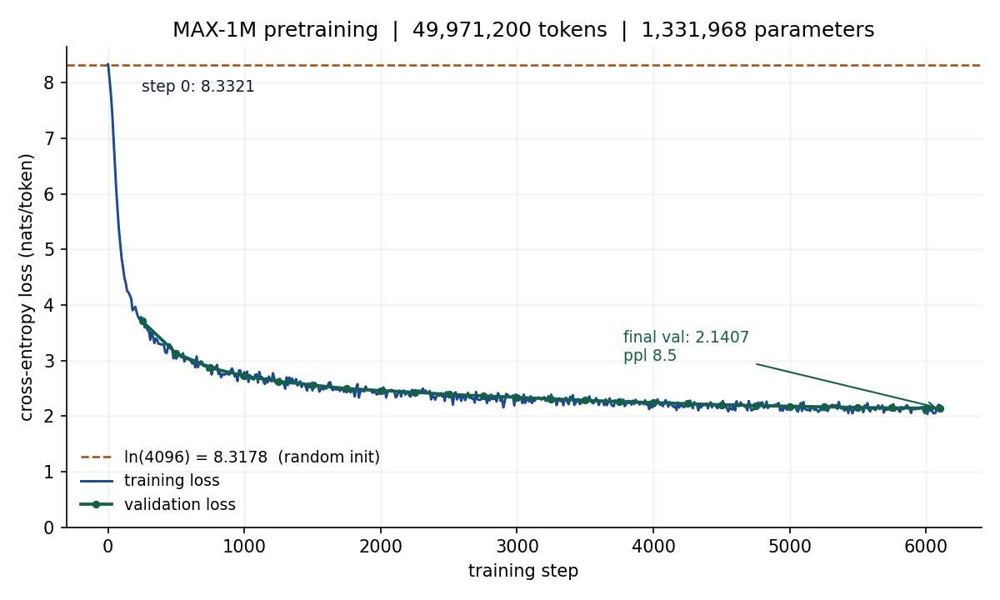

# MAX — Multi-Agent Explainable AI with Collaborative Neural Reasoning

A decoder-only Transformer **implemented from scratch and trained from random initialisation** —
no pretrained weights, no fine-tuning, no API model — specialised into five collaborating reasoning
agents and evaluated against the baselines that make the comparison honest.

> **Research question.** Can several specialised agents built on a model we trained ourselves improve
> reasoning accuracy, calibration and explainability over a single agent **at a matched inference
> budget**? Because the corpus and the benchmark are both generated by us, no test item can have
> appeared in anyone's pretraining data — a contamination guarantee that work built on downloaded
> models cannot make.

---

## Status of every number in this repository

This project's hardest rule is that a measurement and a plan never look alike. Each table below
carries one of these labels, and nothing else is claimed.

| Label | Meaning |
|---|---|
| **MEASURED** | produced by a run in this repository; the manifest is committed |
| **CALCULATED** | arithmetic from the config, asserted by a test |
| **NOT YET MEASURED** | the code is written and tested; the run has not happened |

---

## Review 1 — the language model · MEASURED

Run `run_a_001` · Tesla T4 (free Colab) · seed 1337 · every value measured, none estimated.

| Metric | Value |
|---|---:|
| Parameters | **1,331,968** |
| Step-0 loss | **8.33214** — compare `ln(4096) = 8.3178` |
| Final validation loss | **2.1407** (perplexity 8.5053) |
| Next-token accuracy@1 | 51.10% |
| Checkpoint reload difference | **0.000000** |
| Training | 6,100 steps · 49,971,200 tokens · 2.6 min · 320,128 tok/s |
| Peak VRAM | 0.83 GB of 15.4 GB |



The dashed line is `ln(4096) = 8.3178` — where a randomly initialised model over a 4,096-token
vocabulary *must* start.

---

## MAX-Reason — our own benchmark · MEASURED

Generated by `reasoning/generators/`. Every label is computed by the code that writes the question,
so nothing is annotated by hand and nothing comes from another model.

| | |
|---|---:|
| Problems generated | 120,000 |
| After exact deduplication | **118,297** (1.42% removed) |
| Train / validation / test | 106,398 / 5,864 / 6,035 |
| **Questions shared between any two splits** | **0** (asserted before writing) |
| Families | arithmetic (7 templates), logic (3 templates) |
| Difficulty | 1–4 reasoning steps, measured as steps not estimated |
| Mean distractors per problem | 2.14, each labelled with the mistake that produces it |
| UNK rate under the Review 1 tokenizer | **0.0000%** |

Three design decisions worth defending at a viva:

**The distractors carry their own error labels.** For every problem the generator also computes the
answer a *specific* plausible mistake would reach — "stopped after multiplying", "applied the rule
backwards" — because it knows which operation it skipped. That is what makes a Critic and a Verifier
trainable without a teacher model.

**Category chains are deliberately not true of the world.** "All dogs are plants" appears on purpose.
If the premises always agreed with world knowledge, a model could score well by recalling facts
instead of applying the rules, and we could not tell the two apart.

**Constraint puzzles are solved before they ship.** Each is brute-forced at generation time and
discarded unless exactly one assignment satisfies every clue. A puzzle with two solutions is a broken
label, not a hard question.

---

## The system

```
question
   │
   ├──────────────┬──────────────┐
   ▼              ▼              │      one checkpoint, five role tokens,
 Solver      Alternative         │      zero extra weights
 (greedy)      (T=0.9)           │
   └──────┬───────┘              │
          ▼                      │
       Critic ──────► Verifier   │
          └──────┬───────┘       │
                 ▼               ▼
            Coordinator ◄── self-consistency draws
                 │
                 ▼
     answer · confidence · decision record
```

All five agents are the **same frozen weights** addressed by a different control token. Any measured
difference between them comes from the role token and the decoding settings, and nothing else.

### The five aggregation methods

Every method is scored on **identical generations** — the agents run once per problem and the results
are cached, so the only thing that differs between rows is the aggregation, not sampling luck.

| | Method | Inference budget |
|---|---|---:|
| M1 | Solver alone | 1 generation |
| M2 | Self-consistency: k Solver samples, majority vote | k generations |
| M3 | Multi-agent majority vote | 4 generations |
| M4 | Confidence-weighted vote with a partial Verifier veto | 4 generations |
| M5 | **Neural fusion** over agent hidden states and confidences | 4 generations |

M2 is the baseline that matters. Beating a single generation with four is easy; most of the
interesting question is whether four *different roles* beat four samples of one role. The results
table reports significance against both.

---

## Reviews 2–4 — built and tested, not yet trained · NOT YET MEASURED

| Component | State |
|---|---|
| MAX-12M (Config B), RoPE, 256 context | **12,211,200 parameters — CALCULATED, asserted by `tests/test_config.py`** |
| Stage 1 pretraining on the mixture corpus | code tested end to end; run not performed |
| Stage 2 reasoning SFT, completion-only loss | code tested end to end; run not performed |
| Stage 3 neural fusion coordinator | code tested; trains on validation bundles only |
| Level 2 evaluation, calibration, ablations, significance | code tested on synthetic bundles |
| Streamlit demo | runs against any trained checkpoint |

Config B's gates, run on CPU in development — the T4 run will produce its own:

```
parameters                12,211,200   matches configs/model_b.yaml exactly
step-0 loss                   8.3801   vs ln(4096) = 8.3178, delta +0.0623
weight init                   PASS     N(0, 0.02); residuals scaled 1/sqrt(2L) = 0.00577
attention                     PASS     our explicit maths matches PyTorch's fused kernel
overfit-one-batch gate        PASS     reached 0.1 at step 70
```

`docs/RUNBOOK.md` is the copy-paste Colab sequence that fills in the rest. Estimated GPU time for
everything after Review 1: **70–100 minutes on a free T4.**

### The pipeline has been run end to end — on CPU, at toy scale

Not a result, and deliberately not in any results table. A deliberately tiny run
(700 pretraining steps and 900 SFT steps on 2 CPU cores, no TinyStories) was done
only to prove every stage executes and that the system learns the *format*:

```
format compliance        88.1%   of agent outputs matched the schema
pairwise disagreement    52.7%   well above the 15% floor, so the methods
                                 are aggregating genuinely different answers
M1 single-agent accuracy  31.3%  on 150 held-out problems
coordinator              refused to train: only 42 usable rows, under the
                                 50-row floor, so M5 fell back to M4 and
                                 labelled itself as having done so
```

Two things to read from that and nothing more. The plumbing works: agents emit
the schema, disagree with each other, and every guard fires when it should. And
the accuracy is what a model this undertrained should produce — the statistical
tests correctly report that **no method is distinguishable from any other** at
this sample size, which is exactly what should happen when there is nothing to
find. The real numbers come from the T4 run.

---

## The from-scratch claim, and how it is verified

Four independent checks, all automated, all still passing for the larger model.

**1 — Step-0 loss equals ln(vocabulary).** A model that has learned nothing spreads probability
evenly, so its cross-entropy is exactly `ln(V)`. A model carrying pretrained weights starts near 3–4.

```bash
python scripts/04_verify_model.py --config configs/model_b.yaml
```

Config B is allowed ±0.25 rather than Config A's ±0.05, for a stated reason: at init the logits are
`h · E`, so their spread grows with `d_model`. The claim is unaffected — the test still separates
"random" from "loaded" by a factor of fifty.

**2 — No pretrained-loading call exists anywhere in the source.**

```bash
pytest tests/test_no_pretrained.py -v
```

Fails the build if `from_pretrained`, `AutoModel`, `hf_hub_download`, `snapshot_download` or
`torch.hub.load` appears in any `.py`, `.yaml` or `.ipynb`, and if `transformers` is ever added to
`requirements.txt`. It also fails if a weight file of unknown origin appears in the source tree.

**3 — The checkpoint is portable.** Reloaded in a process that trained nothing, Review 1's model
reproduced its validation loss with a difference of `0.000000`.

**4 — Targets are correctly aligned.** Because the LM head is tied to the token embedding, an
off-by-one in the targets would make step-0 loss land near 7.30 instead of 8.33 — so the `ln(V)`
check also proves the training objective is wired correctly.

**`--init-from` is not a loophole.** Stage 2 starts from Stage 1's checkpoint: weights this project
sampled and trained, two stages earlier. The rule is about never starting from weights someone else
trained.

**212 tests pass.** `pytest tests/ -q`

---

## Models

| Setting | A · MAX-1M | B · MAX-12M |
|---|---:|---:|
| Role | Review 1 | the main system |
| Vocabulary | 4,096 | 4,096 *(shared — see below)* |
| d_model / layers / heads | 128 / 4 / 4 | 384 / 6 / 6 |
| d_ff | 512 | 1,536 |
| Context | 128 | 256 |
| Positional | learned absolute | **RoPE** (0 parameters) |
| **Parameters** | **1,331,968** | **12,211,200** |
| Step-0 loss = ln(V) | 8.3178 | 8.3178 |

```
token embedding      4,096 × 384                        =  1,572,864
positional           RoPE — parameter-free              =          0

per transformer block
  attention   W_q, W_k, W_v, W_o   4 × (384 × 384)      =    589,824
  2 layernorms                     2 × (2 × 384)        =      1,536
  feed-forward  384×1536 + 1536  +  1536×384 + 384      =  1,181,568
  ----------------------------------------------------------------
  one block                                             =  1,772,928
  × 6 layers                                            = 10,637,568

final layernorm            2 × 384                      =        768
LM head                    tied to embedding            =          0
==================================================================
TOTAL                                                     12,211,200
```

**Two documented departures from the original blueprint**, both deliberate and both asserted by
tests so they stay deliberate:

1. **The vocabulary stays at 4,096** rather than being refitted to 8,192. Every checkpoint in the
   project therefore shares one tokenizer and one fingerprint — `d6080bac0a9a` — so Review 1's work
   is reused rather than rebuilt, and the 51.6M already-encoded tokens carry straight over. The cost
   is slightly longer sequences on ordinary English; the benefit is that digits stay close to
   character-level, which is what multi-step arithmetic wants. This is also why the count is 12.2M
   rather than the blueprint's 13.8M: the difference is exactly the embedding rows we did not add.

2. **RoPE replaces the learned position table**, saving 98,304 parameters and making attention a
   function of relative distance. `tests/test_rope.py` asserts the relative-distance property
   directly, rather than trusting the implementation.

---

## A bug worth reporting

While building Stage 2 we found that `reasoning/schema.parse()` counted a role's **first** field as
missing. Prompts end with that field's marker, so the model never emits it — which capped format
compliance at zero no matter what the model produced. Review 1's reported **0% format compliance for
the V0 agent stub was therefore partly a parser artefact**, not only an untrained model.

The parser is fixed and `tests/test_reasoning_data.py` pins the behaviour. The Review 1 figure is
left as it was reported, with this correction recorded here rather than quietly restated.

---

## Repository layout

```
configs/          YAML — data, tokenizer, model_a/b, train_a/b, sft_b
tokenizer/        our BPE trainer, encoder/decoder, special-token registry
model/            attention.py · block.py · transformer.py · rope.py · init.py
training/         data.py · sft_data.py · optim.py · checkpoint.py · trainer.py
reasoning/        generators/ (arithmetic, logic) · problem.py · render.py · schema.py
agents/           base.py · roster.py · protocol.py
collaboration/    aggregate.py (M1–M5) · fusion.py (the neural coordinator)
explainability/   decision_record.py · graph.py
evaluation/       level1.py · level2.py · calibration.py · stats.py
inference/        load.py — checkpoint loading with the fingerprint guard kept on
app/              streamlit_app.py — the demo
scripts/          01–17, run in order; docs/RUNBOOK.md is the Colab sequence
tests/            212 tests, including the no-pretrained-weights guard
```

Two rules enforced throughout: **no file over ~300 lines**, and **every run writes a manifest**
recording seed, config, config hash, dataset revision, tokenizer fingerprint, git commit and hardware.

---

## Quickstart

```bash
pip install -r requirements.txt
pytest tests/ -q

# exercise the whole pipeline in ~1 minute, no GPU
python scripts/11_generate_reasoning.py --n 2000
python scripts/12_build_sft.py --max-problems 500
python scripts/04_verify_model.py --config configs/model_b.yaml
```

The full sequence, including GPU stages, is in [`docs/RUNBOOK.md`](docs/RUNBOOK.md).

---

## Current limitations

Stated plainly, because each follows from a deliberate scope decision:

- **12.2M parameters.** Small models reason poorly. The honest expectation is modest accuracy, and
  the evaluation is built to report that rather than to flatter it.
- **A generated benchmark, not a human one.** Contamination-free and exactly labelled, but narrower
  than human-written reasoning problems. Generalisation beyond these ten templates is not claimed.
- **Agent independence is measured, not assumed.** All five agents share weights, so they can
  correlate. Mean pairwise disagreement is a first-class metric and the evaluation refuses to
  interpret the comparison when it falls below 15%.
- **Explanations are system-level.** The decision record states what executed, what each agent
  concluded and how confident it measurably was. It does not claim to explain why the model produced
  a particular token; attention attribution is reported as attention weight, which is not the same
  thing as a reason.
- **One training run.** Run-to-run variance across seeds is not yet measured.

---

## Documentation

- [`docs/RUNBOOK.md`](docs/RUNBOOK.md) — the full Colab sequence, with failure modes
- [`docs/Review1_StudyGuide.pdf`](docs/Review1_StudyGuide.pdf) — 41-page technical guide, 42 viva questions
- [`docs/Review1_Presentation.pptx`](docs/Review1_Presentation.pptx) — 22-slide review presentation
- [`docs/PROJECT_BLUEPRINT.md`](docs/PROJECT_BLUEPRINT.md) — complete analysis and roadmap

## References

- Vaswani et al. (2017), *Attention Is All You Need*
- Radford et al. (2018, 2019), the GPT decoder-only architecture and initialisation recipe
- Sennrich et al. (2016), *Neural Machine Translation of Rare Words with Subword Units* (BPE)
- Su et al. (2021), *RoFormer: Enhanced Transformer with Rotary Position Embedding*
- Eldan & Li (2023), *TinyStories: How Small Can Language Models Be and Still Speak Coherent English?*
- Wang et al. (2022), *Self-Consistency Improves Chain of Thought Reasoning* — the M2 baseline
- Guo et al. (2017), *On Calibration of Modern Neural Networks* — ECE and reliability diagrams

## License

Code released under the MIT License — see [LICENSE](LICENSE).
The TinyStories dataset is licensed CDLA-Sharing-1.0 by its authors and is not redistributed here.
